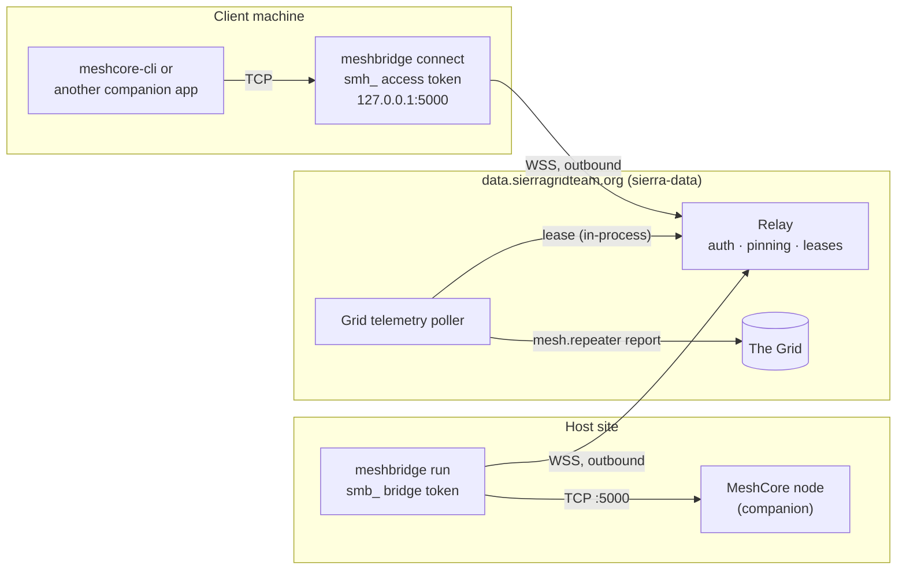

# sierra-meshrelay

Remote access to MeshCore companion radios for [The SIERRA Grid](https://sierragridteam.org). A host's radio connects to the **relay** through **meshbridge**. Authorized clients, people or SIERRA's own services, reach the radio through the relay. The bridge dials out over WebSocket, so nothing connects in to the host's network.

This repo holds all three parts:
- the wire protocol (`PROTOCOL.md` and the Go types in `meshproto/`),
- the relay (`relay/`), a Go library,
- the bridge (`cmd/meshbridge`).

A protocol change, the relay, the bridge and their end-to-end tests land in one pull request.

## Quick start: install a bridge

A host needs an always-on computer on the same network as a WiFi or Ethernet MeshCore companion node, and a passphrase from a SIERRA admin (see [Inviting a host](#inviting-a-host-sierra-admins)).

**Linux** (x86-64, arm64 or Raspberry Pi):

```sh
curl -fsSL https://raw.githubusercontent.com/sierragridteam/sierra-meshrelay/main/scripts/install.sh | sh -s -- --passphrase "maple river quartz otter"
```

**Windows 10 or 11**, from an elevated PowerShell (right-click PowerShell, **Run as administrator**), or over SSH as an administrator:

```powershell
& ([scriptblock]::Create((irm https://raw.githubusercontent.com/sierragridteam/sierra-meshrelay/main/scripts/install.ps1))) -Passphrase "maple river quartz otter"
```

The installer:
1. Downloads the latest release for the machine's CPU and checks it against the release's `SHA256SUMS`.
2. Installs the binary.
3. Runs `meshbridge setup`, which:
   - scans the LAN for a node on port 5000 and runs the identity check;
   - asks which node is yours if it finds more than one;
   - redeems the passphrase.
4. Installs and starts the service. It starts at boot, restarts after a crash, and updates itself.

Without `--passphrase` (`-Passphrase` on Windows), setup asks for one. Press Enter instead to get a pairing code to send to an admin. If the node is on another subnet, pass `--host 192.168.1.50` (`-NodeHost` on Windows). Running the installer again upgrades the bridge and skips pairing.

Details, options and troubleshooting: [docs/linux.md](docs/linux.md), [docs/windows.md](docs/windows.md).

## How it fits together

The same `meshbridge` binary runs at the host site and on a client's machine, with the relay in the middle. Arrows point the way each connection is dialed: both ends dial out to the relay.



- **`meshbridge run`** runs at the host site, on an always-on computer on the same network as the node. It holds the node's single companion connection and dials out to the relay with the gateway's bridge token (`smb_…`).
- **The relay** does four things:
  - authenticates bridges and clients;
  - pins each gateway to its node's pubkey;
  - gives one client at a time a lease on a gateway;
  - forwards that client's frames to the node and back.
- **Clients** hold a lease while they use a node:
  - **`meshbridge connect <gateway>`** runs on your machine. It makes the remote node look like a local radio on `127.0.0.1:5000` for meshcore-cli and other TCP companion apps. It uses an access token: a host token for that one gateway (`smh_…`), or an admin's (`smc_…`).
  - **SIERRA's services**, such as the Grid's telemetry poller, run in-process with the relay and use the same leases.

A gateway is the relay's record for one bridge and its node: a name, a token, a pinned pubkey.

## Design

### The bridge is simple, stable software

The bridge forwards companion frames between the node and the relay. It has no mesh logic:
- It doesn't schedule anything.
- It doesn't interpret messages, other than the identity check it runs when it connects to the node.
- It doesn't store traffic.

Its other jobs are local:
- finding the node on the LAN,
- pairing,
- pausing,
- installing itself as a service,
- updating itself.

New uses of the mesh don't need a new bridge release. That matters because bridges run on volunteers' computers that nobody at SIERRA can log in to. Each bridge release is a rollout to every host.

### Logic lives in the consumer

What to do with a node belongs to the service that uses it. The relay provides the primitives:
- leases with priorities,
- companion operations over a lease (`meshops`),
- a check of a shared repeater (`CheckRepeater`),
- records of every check.

For the Grid, the telemetry poller lives in [sierragridteam/sierra-data](https://github.com/sierragridteam/sierra-data) (`internal/relaytelemetry`). It decides:
- when to read each repeater,
- which gateway to use,
- how to retry and fail over,
- when to back off a repeater that stays unreachable.

Changing that policy means deploying sierra-data. Bridges stay as they are.

### Tradeoff: no buffering

A bridge doesn't collect or store anything while the relay is unreachable, and the relay doesn't store traffic. If every gateway that can reach a repeater is offline, the Grid gets no readings for it until one comes back. The gap is visible on the Grid, and nothing is filled in afterwards.

The mitigation is redundancy, not storage. A shared repeater is a property of SIERRA, not of the gateway that shared it, so any gateway whose node has heard it can read it. The poller tries the gateway that last reached it first, then the others. More gateways in an area means fewer gaps.

### Other principles

- **Outbound only.** Both ends dial out to the relay, so neither side opens a port, changes its router or needs a public IP. It works behind CGNAT.
- **One user of a node at a time.** A companion node accepts one connection, so a lease is exclusive and time-limited. Priorities apply:
  - a person (or agent) preempts a background poller;
  - a poller that finds a gateway busy moves on.
- **The host stays in control.** `meshbridge pause` ends the current lease and frees the node for the host's own MeshCore app.
- **Client traffic is opaque, with one exception.** The relay doesn't otherwise parse frames on a client's lease, and no component logs frame payloads: they can carry private messages and channel keys.
- **Remote sessions can't take the node's secrets.** Every lease, including admins' and the owner's, is refused the commands that export or replace the node's private key, factory reset it, read its WiFi password, give a contact remote CLI access, or start a wadamesh firmware update. The bridge and the relay both enforce this. See "Node command policy" in [PROTOCOL.md](PROTOCOL.md).
- **Trust is anchored in the node.** The relay pins each gateway to its node's MeshCore pubkey. A node with a different key (a swapped radio, or one reflashed with a new identity) is refused until an admin accepts the new key.
- **Every frame goes through the relay.** There is no direct path between peers. MeshCore traffic is a few small frames per second, so the extra hop adds little. Routing everything through the relay puts access control and auditing in one place.
- **Access is to one node, not a network.** A lease reaches one gateway's companion session. It gives no IP access to the host's LAN, and the bridge only talks to the node.
- **Updates are signed.** CI signs each release. A bridge installs an update only if it verifies against the public key built into it, and only once the relay offers that version (`meshbridge admin update-bridges`).

## Status

- **Relay:** live at `data.sierragridteam.org`, deployed by sierra-data. It covers:
  - bridge and client sessions, leases and pinning;
  - pairing (device codes and passphrase invites), pause and bridge updates;
  - shared repeaters, the admin API and public status.
- **Not built yet:** the web approval page at `/mesh/pair`. Admins approve with `meshbridge admin`.
- **Bridge:** runs on Linux (systemd) and Windows 10/11 (a Windows service), with TCP (WiFi or Ethernet) nodes. USB serial nodes aren't supported yet.

## Inviting a host (SIERRA admins)

Admin commands read the admin token from `$MESHBRIDGE_ADMIN_TOKEN` or `~/.config/meshbridge/admin.token` (chmod 600).

1. Create an invite:

   ```sh
   meshbridge admin invite jay-murphys
   ```

   This prints the invite's ID, gateway name, uses and expiry, then the passphrase (four words, shown once), then a message to send the host. The message holds the passphrase and the Linux and Windows install commands with the passphrase filled in.

2. Send the message to the host over a private channel. Anyone with the passphrase can pair a bridge until the invite is used or expires.

3. The host runs the install command. Setup redeems the passphrase and the relay:
   - creates the gateway,
   - pins it to the node's pubkey,
   - returns a bridge token.

   There is no approval step: the invite is the approval. The bridge writes its config and the service connects.

4. Check it:

   ```sh
   meshbridge admin gateways          # online, node connected, version
   meshbridge admin logs jay-murphys  # the bridge's own log lines
   ```

Invite options:

| Option | Effect |
|---|---|
| `[gateway]` | The gateway's name. Omit it to name the gateway after the node when the invite is redeemed. |
| `-uses N` | How many bridges the invite can set up (default 1). |
| `-prefix p` | With `-uses`: name the gateways `p-1`, `p-2`, and so on. |
| `-days N` | Days until it expires (default 7, at most 30). |
| `-node <pubkey>` | Only the node with this pubkey can redeem it. |
| `-note "…"` | A note for admins. |

Manage invites:
- `meshbridge admin invites` lists them; the passphrase is never shown again.
- `meshbridge admin revoke <invite-id>` revokes one. Gateways it already created keep working.

Rules the relay enforces:
- Every failed redemption gets the same answer, whether the passphrase is wrong, expired, used up or revoked, or the node doesn't match `-node`.
- Passphrase attempts are rate-limited: 10 per IP and 200 in total per hour.
- Each redemption adds a `paired` (or `repaired`) event to the gateway's log, with the source IP.

**Without an invite**, a host presses Enter at the passphrase prompt and gets a pairing code (for example `K7M-4QX`) to send to an admin:

```sh
meshbridge admin pairings                  # codes waiting, with the computer, node and proposed name
meshbridge admin approve K7M-4QX           # named after the node; or: approve K7M-4QX jay-murphys
meshbridge admin deny K7M-4QX
```

Pending codes are held in memory, so a relay restart drops them, and setup then offers a new code.

**Re-pairing** (a new computer, or a lost config): send an invite that names the existing gateway. Redeeming it rotates the gateway's token, disconnects the old bridge and re-pins the node. A new computer just runs the installer.

**Gateways can't be renamed.** To change a name:
1. Run `meshbridge admin remove <gateway>`. This revokes its token and disconnects it. Repeaters it shared stay shared.
2. Send an invite with the new name.

On a computer that is already paired (both cases), the installer skips pairing. The host instead:
1. Stops the service: `sudo systemctl stop meshbridge`, or `Stop-Service meshbridge` on Windows. Setup needs the node's one connection.
2. Runs `sudo meshbridge setup -repair` (on Windows, `meshbridge setup -repair` in an elevated PowerShell) and gives the new passphrase.
3. Starts the service again: `sudo systemctl start meshbridge`, or `Start-Service meshbridge`.

## Using a bridge

### Host commands

Run these on the host. Linux needs `sudo`; Windows needs an elevated PowerShell.

```sh
meshbridge status                    # green / amber / red, node, last traffic, pause state
meshbridge pause 1h                  # or: tomorrow (08:00), until-resumed
meshbridge resume
meshbridge reconnect                 # look for the node now (after restarting it), not at the next retry
meshbridge change-node               # switch to a different node (a replacement or a reflashed one)
```

`change-node` finds the new node, tells SIERRA (which re-pins the gateway to it and records the change in its logs), saves it in the config and restarts the service. The gateway keeps its name, token and shared repeaters.

While the node is unavailable, `status` says since when, why, and where it was last connected. The bridge retries on its own about every 30 seconds (plus the time a network scan takes); `reconnect` skips the wait. If a SIERRA client is using the node, `reconnect` needs `-force`, because it ends that session.

These talk to the running bridge's control API on `127.0.0.1:8737`, authenticated by the `control.token` file next to the config. A pause with no end time (`until-resumed`) survives a restart. A timed pause doesn't.

### Sharing repeaters

```sh
meshbridge repeater add              # pick a repeater the node has heard, enter its (guest) password
meshbridge repeater add ridge        # only repeaters whose name contains "ridge"
meshbridge repeater list             # what this bridge shared, when SIERRA last read each, polling state
meshbridge repeater remove "Ridge RPT"
```

Run these on the bridge's computer (with sudo, or as an administrator on Windows): they act as that bridge, using the token in its config. On any other computer they say there's no bridge set up there. Admins manage every shared repeater from anywhere with `meshbridge admin repeaters` and `admin repeater add|remove`.

SIERRA logs in to a shared repeater over the mesh to read its status (battery, airtime, packet counts) for the Grid:
- Any SIERRA gateway in range may be used, not only the one that shared it.
- The relay checks the password by logging in before it stores it, encrypted.
- A guest password is enough, and it can only read status.
- Removing a repeater deletes its password.

### Using a remote gateway (client mode)

```sh
MESHBRIDGE_CLIENT_TOKEN=smh_… meshbridge connect mission-gateway
meshcore-cli -t 127.0.0.1 -p 5000 infos
```

The token is a host token for that gateway (`smh_…`, from a SIERRA admin; it opens that gateway only) or an admin token (`smc_…`).

How `connect` behaves:
- It listens on `127.0.0.1:5000` and takes a lease only while an app is connected.
- It serves one app at a time and renews the lease while the app is active.
- It explains a refusal (busy, offline, paused).
- `-listen` chooses another address. A non-loopback address prints a warning, because companion apps have no authentication.

### Admin commands

```sh
meshbridge admin gateways                   # bridges, nodes, versions, last seen
meshbridge admin logs <gateway> -f          # a bridge's log lines (never message content)
meshbridge admin reconnect <gateway>        # have a bridge look for its node now; -yes if a client is using it
meshbridge admin accept-node <gateway>      # accept the node a bridge reports when it isn't the one on record
meshbridge admin remove <gateway>           # revoke and disconnect a gateway
meshbridge admin update-bridges v0.8.1 -gateway mission-gateway   # offer a release to one gateway (canary)
meshbridge admin update-bridges v0.8.1      # then to all; "off" stops offering
meshbridge admin update-bridges             # show what is offered now (changes nothing)
meshbridge admin repeaters                  # shared repeaters: last read, polling state, each gateway's last 24h
meshbridge admin repeater add <gateway> [name]    # share a repeater any host's gateway has heard (pick from its list)
meshbridge admin repeater add <pubkey> <gateway>  # or name it by pubkey
meshbridge admin repeater remove <name or pubkey>
```

## Development

### From source

```sh
make build
./bin/meshbridge setup -config meshbridge.local.toml      # finds the node on the LAN; pairs by passphrase or code
./bin/meshbridge run   -config meshbridge.local.toml
```

Setup writes the config, readable only by you: the token, the relay URL, and the node's address and expected pubkey. To configure by hand instead, copy `examples/meshbridge.toml` and set `MESHBRIDGE_TOKEN`.

`./bin/meshbridge find-node -host 192.168.1.50` runs the identity check against a TCP node. It prints the node's name, pubkey, model and firmware. Use that pubkey as `node.expected_pubkey`.

### A local relay

`go run ./cmd/devrelay -gateway cabin` runs the real relay on `127.0.0.1:8090` with a throwaway database. It prints an admin token, the gateway's bridge token, a host token for it and commands to paste. Use it to try a bridge, `connect`, pairing or pause without the production relay.

To pair against it:
1. Run `meshbridge setup -relay ws://127.0.0.1:8090/mesh/relay`.
2. Approve the code: `curl -X POST -H "Authorization: Bearer <admin>" -d '{"gateway":"cabin2"}' http://127.0.0.1:8090/mesh/relay/api/pairings/<code>/approve`.

Without a radio, run `./bin/fakenode -listen 127.0.0.1:5000` and point `tcp_host` at it. The fake node answers `APP_START` and `DEVICE_QUERY`, and echoes every other frame back with a `0x80` prefix.

### Where the relay runs

`relay/` is a library. The deployed relay is `cmd/mesh-relay` in [sierragridteam/sierra-data](https://github.com/sierragridteam/sierra-data). It imports this module and adds:
- sierra-data's config,
- its deploy handoff (passed in as `relay.Config.Gate`),
- the Grid telemetry poller,
- the Docker image and the deploy.

To ship a relay change:
1. Merge it here and tag a release.
2. Bump `github.com/sierragridteam/sierra-meshrelay` in sierra-data through a pull request.
3. Deploy sierra-data.

### Testing

| Command | What it runs | Needs |
|---|---|---|
| `make test` | Every package's tests, plus the `e2e/` tests that run the real relay and real bridge in one process, with a fake node and a TCP client through `connect`. They cover the full chain, throttling, pinning, leases and preemption, pause, pairing, invites, updates and shared repeaters. | Nothing |
| `make test-dynamo` | The DynamoDB store's tests (the shared store conformance suite, the instance lease, the relay.db import) and the local `e2e/` suite with the relay on DynamoDB. See [docs/dynamodb.md](docs/dynamodb.md). | Docker (starts `amazon/dynamodb-local`) |
| `make test-live` | The real bridge and a fake node against the **production** relay on `bridge-dev-sim`: leases, round trips, a 300-frame burst, renew, busy, and the chain through `connect`. | Parent workspace `.envrc` (loaded by direnv) with `RELAY`, `SIM_BRIDGE_TOKEN`, `CLIENT_TOKEN` |
| ↳ admin checks | Relink via the admin API | `ADMIN` too; these skip without it |

Windows CI also runs the install script, the Windows service and a signed auto-update end to end.

Live-test rules:
- `bridge-dev` is reserved for real hardware. The relay pins a gateway to the first node pubkey it sees, so fake nodes stay on `bridge-dev-sim`.
- Don't run two bridges with the same token. They replace each other (4009).
- Never log frame payloads.

## Docs

- [PROTOCOL.md](PROTOCOL.md): the wire protocol. It's the canonical spec; the Go types in `meshproto/` are tested against its examples.
- [docs/linux.md](docs/linux.md), [docs/windows.md](docs/windows.md): running a bridge as a service.
- [docs/relay.md](docs/relay.md): the relay's API, design decisions and deployment requirements.
- [docs/dynamodb.md](docs/dynamodb.md): the relay's DynamoDB store, its instance lease and moving a relay.db to it.
- [docs/mesh-bridge-handoff.md](docs/mesh-bridge-handoff.md): the bridge's original design and milestones.

## Layout

| Path | |
|---|---|
| `PROTOCOL.md`, `meshproto/` | The wire protocol spec and its Go types |
| `relay/` | The relay: sessions, leases, pinning, pairing, shared repeaters, SQLite store, admin API |
| `relay/dynamostore`, `relay/storetest` | The DynamoDB store, and the conformance suite both stores pass |
| `cmd/relaydynamo` | One-off relay.db to DynamoDB import and verification |
| `meshops/` | Companion operations over a lease (contacts, repeater login and status), and `meshsim`, a simulated mesh for tests |
| `cmd/meshbridge` | The CLI: host commands, `connect`, `admin` |
| `cmd/devrelay` | The real relay on localhost, for development |
| `cmd/fakenode` | A standalone fake companion node |
| `cmd/signrelease` | Signs a release's checksums (CI) |
| `internal/bridge` | Node manager, relay session, reconnect backoff |
| `internal/companion` | Companion framing and the identity check (verified against MeshCore companion-v1.18.0) |
| `internal/nodelink` | Node link interface, TCP link, LAN rediscovery |
| `internal/relayclient` | Client side of the relay protocol |
| `internal/connect` | `meshbridge connect`: local TCP companion port ↔ relay lease |
| `internal/control` | The bridge's local control API (status, pause, resume) and its client |
| `internal/pairing` | The bridge side of pairing |
| `internal/admin` | The admin and gateway API client |
| `internal/update` | Signed self-update |
| `internal/svc` | Service install: systemd and Windows service |
| `internal/config`, `internal/state` | The bridge's config file and `state.json` |
| `internal/logfile`, `internal/diaglog` | The bridge's log file, and the log lines it sends the relay |
| `internal/relaytest`, `internal/fakenode` | Test doubles: a scripted relay and a fake node |
| `e2e` | End-to-end tests: local (real relay in process) and live (production relay) |

## License

MIT
